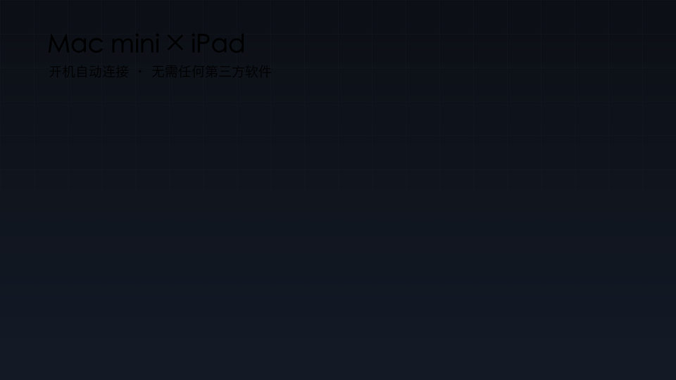

<p align="center">
  
</p>

<p align="center">
  <b>Turn a display-less Mac mini into a workstation whose only screen is an iPad</b><br>
  Purpose-built virtual display · direct Sidecar control · no third-party apps · auto-connect on boot · self-healing · tamper-proof
</p>

<p align="center">
  <a href="README.md">中文</a> · <b>English</b>
</p>

<p align="center">
  
  
  
  
  
</p>

---

<p align="center"></p>

> ### On paid versions
>
> Everything here is free and open source (MIT). If you find someone reselling a
> packaged copy elsewhere, remember: you can get the same capability here for nothing.
>
> What this project relies on is provided by macOS itself — no paid app invented it.
> May it reach everyone who either cannot afford the paid route, or simply does not want it.

## What this is

A Mac mini sits in the living room with no monitor, no keyboard — just a power cable.
Walk over with an iPad and it lights up as the Mac's screen. Walk away and it waits quietly. Come back and it reconnects on its own.

Three components make that happen:

| Capability | Implementation |
|---|---|
| **Create a screen that doesn't physically exist** | `vdisplay` — ~120 lines of Objective-C on top of Apple's `CGVirtualDisplay` |
| **Drive Sidecar to that screen** | `sidecarctl` — ~110 lines of Objective-C calling `SidecarCore` directly |
| **Keep it working** | `sidecar-guard` (connection watchdog) + `protectd` (root-level integrity daemon) + four `launchd` agents |

No third-party application is installed. This is not a free clone of a paid product — it drives the macOS subsystems that exist but are not exposed.

## Measured results

| Metric | Value |
|---|---|
| Cold boot → desktop visible on iPad | **16–34 s** (≈20 s of that is the system's Bluetooth stack coming up) |
| Link drop → automatic recovery | **2–10 s** |
| Universal Control (keyboard) link | ready at boot, **0 s** |
| Requirements on the iPad | **no app at all** — same Apple ID is enough |
| Native panel | 2646×1838 (HiDPI 2×, 1:1 with the iPad panel) |
| Third-party dependencies | **0** |

## How it compares

Every other approach we could find needs either hardware or third-party software:

| Approach | Hardware | Software | Auto-connect | Cost |
|---|---|---|---|---|
| HDMI dummy plug + remote desktop | ✅ required | ✅ VNC / Sunshine | partial | $5–15 |
| BetterDisplay + connector app | ❌ | ✅ two apps | ✅ | $20+ |
| Luna Display | ✅ dongle | ✅ app | ❌ manual | ~$130 |
| Duet Display | ❌ | ✅ app | ❌ manual | subscription |
| **This project** | ❌ | ❌ | ✅ | **free** |

The difference is where the work happens: **the virtual display is built here, and the session is opened by calling Apple's private API directly** — so there is no dongle to buy and no app to install.

## How it works

```
┌────────────── Mac mini (no display) ──────────────┐
│ launchd                                           │
│  ├ vdisplay       creates virtual display         │
│  ├ sidecar-guard  polls every 5 s, connects       │
│  ├ vmenu          menu bar: modes / pause         │
│  └ ucguard        Universal Control watchdog      │
│                                                   │
│ SidecarCore (Apple private framework)             │
│  devices          → iPads on the same iCloud      │
│  connectToDevice: → opens a Sidecar session       │
│                                                   │
│ WindowServer → Sidecar → mirrored to the display  │
└───────────────────────┬───────────────────────────┘
                        │ same Apple ID + BT / Wi-Fi
                        ▼
              ┌────────────────────┐
              │ iPad (only screen) │  nothing to install
              └────────────────────┘
```

The iPad is purely a receiver. The Mac initiates every session, so a powered-off, locked, or app-less iPad never blocks the design.

## Components

| Path | Language | Size | Role |
|---|---|---|---|
| `src/vdisplay.m` | Objective-C | ~120 lines | HiDPI virtual display with four modes (800/1001/1180/1323) |
| `src/sidecarctl.m` | Objective-C | ~110 lines | list / connect / disconnect; binds to a specific device UUID |
| `src/vmenu.m` | Objective-C | ~330 lines | menu bar: four resolutions, glass highlight on the active one, pause toggle |
| `scripts/sidecar-guard` | Bash | ~150 lines | trigger-driven reconnection: USB > proximity > timer |
| `protectd/protectd` | Bash | ~130 lines | root watchdog: restore files, re-apply flags, reload agents, recover hung processes |
| `scripts/sidecar-*` | Bash | ~200 lines | status, self-check, report, pause, resume |

Everything is source. There are no prebuilt binaries and no closed dependencies.

## Quick start

### Prerequisites

- Apple Silicon Mac (verified on macOS 26/27) and an iPad signed into the **same Apple ID**
- Bluetooth and Wi-Fi enabled on the iPad (USB-C works too, and gives the most stable link)
- The Mac must already be signed into that Apple ID — Sidecar device discovery runs over iCloud/IDS

### Install

```bash
git clone https://github.com/duandayi/macmini-headless-ipad.git
cd macmini-headless-ipad
./install.sh
```

The script checks prerequisites (Xcode Command Line Tools, macOS version), compiles the three binaries into `~/.local/bin`, installs four LaunchAgents, then runs the self-check.

First connection, once:

```bash
sidecarctl list          # your iPad should be listed
sidecarctl connect       # opens the session; macOS remembers the mirror
sidecar-status           # expect connected=yes
```

### Let an AI agent deploy it

The repository is written to be deployed by a coding agent:

```
Point your agent at this repository and say:
"Deploy this project following AGENTS.md,
 then run sidecar-doctor and show me the result."
```

`AGENTS.md` documents every step, every known failure mode, and the acceptance checks, so the agent does not have to guess.

## Menu bar

| Action | Result |
|---|---|
| Hover the icon | Shows the current resolution |
| Click | Four modes: `1180×820` (1:1 native) · `1323×919` · `1001×696` · `800×600` |
| Active mode | Highlighted with a light-blue glass overlay |
| Pause auto-reconnect (⌘P) | For when you need the iPad elsewhere (meetings, gaming); **auto-resumes after 10 minutes** |

**Cover-closed standby (new in v22)**

When the iPad is closed or put away, the Mac stops reconnecting and releases the virtual display within **3 minutes**, then waits quietly:

- Trigger: iPad invisible over Bluetooth for **≥180 s** *and* the Mac idle for **≥120 s**
- While waiting: session disconnected, virtual display released, no reconnection attempts (the Mac stays awake, ready to resume)
- Wake: as soon as the iPad is visible again, the virtual display is rebuilt and the session reconnects — **without touching the Mac**
- Never triggers when: connected over USB, auto-reconnect paused, or the Mac is in active use

Thresholds are configurable: `SIDECAR_STANDBY_SECS` (default 180) and `SIDECAR_STANDBY_IDLE` (default 120).

## Tamper protection

> Background: a cleanup utility once cleared the login items, the whole connection stopped working, and nothing warned about it.

The components are protected on three levels:

**Layer 1 — master copies**
Everything under `/usr/local/libexec/dsh-sidecar/` is `schg` (system-immutable) and owned by `root:wheel`; even root has to clear the flag first.

**Layer 2 — user copies**
Everything in `~/.local/bin/` is `uchg`; ordinary processes get `Operation not permitted`.

**Layer 3 — root daemon**
A sweep every 20 s: modified file → restored; lost flag → re-applied; agent unloaded → reloaded; process killed → restarted; hung guard → `SIGKILL` within 2 minutes.

Verified behaviour (details in [docs/系统级保护.md](docs/系统级保护.md)):

| Attempt | Result |
|---|---|
| Modify a binary as a normal user | `Operation not permitted` |
| Modify the master copy **as root** | `Operation not permitted` (schg) |
| `launchctl bootout` an agent | reloaded in ~40 s |
| Clear `uchg`, edit the user copy | reverted and re-locked in 15 s |
| `kill -STOP` the guard | heartbeat goes stale → `SIGKILL` → restarted within 2 min |

Optional installation (one administrator password prompt):

```bash
sudo ./protectd/install-protectd.sh
```

**Limit, stated honestly:** anyone holding your administrator password can still change these files — they only have to clear the flag first. That is the ceiling of the macOS permission model; no software can exceed it.

## Troubleshooting

- **iPad stays black** — no virtual display, or no session → `sidecar-status`, `sidecar-doctor`
- **Menu items do nothing** — the guard is paused → choose "Resume" or run `sidecar-resume`
- **"Wi-Fi is not available on the device"** — Wi-Fi disabled on the iPad → enable it; reconnects within 10 s
- **Device not found** — iPad powered off or Bluetooth off → power on; reconnects within 2 minutes
- **Blurry output** — not running at 1:1 → pick `1180×820` in the menu
- **Keyboard keeps dropping** — another display tool is rewriting the configuration → remove it

Full pitfall log with real system log excerpts: [docs/踩坑记录.md](docs/踩坑记录.md) (Chinese).

## Not an iPad?

The transport layer is **Sidecar**, which is iPad-only. The project splits cleanly in two:

| Layer | This project | Portable? |
|---|---|---|
| A. Virtual display (make the Mac believe a screen exists) | `vdisplay` | ✅ works with any transport |
| B. Deliver the picture | Sidecar | ❌ iPad only |

- **Android tablet:** keep A and replace B with [Sunshine](https://github.com/LizardByte/Sunshine) + Moonlight, or Deskreen.
- **Remote access only:** an HDMI dummy plug (a few dollars) is the simplest option and needs no software at all.
- **No tablet:** this project does not apply.

Do not buy an iPad for this project.

## Compatibility and test status

- Verified on: **Mac18,5 / Apple M6 / 16 GB / macOS 27.0**
- Cold-boot validation: **repeatedly passed** (16–34 s to connect, zero manual intervention)
- Long-term soak test: **in progress** (`sidecar-report` records boot-to-connect time and interventions)
- Not verified: older macOS releases, Intel Macs, multiple iPads online at once
- The private APIs (`CGVirtualDisplay`, `SidecarCore`) are undocumented and may change in a future macOS release; `sidecar-doctor` will surface that first

When filing an issue, include the output of `sidecar-doctor`.

## Repository layout

```
.
├── install.sh / uninstall.sh      install / remove
├── config.example.sh              sample config (device binding)
├── src/                           vdisplay.m · sidecarctl.m · vmenu.m
├── scripts/                       guard · doctor · status · report
├── launchd/                       agent templates
├── protectd/                      system-level protection (optional)
├── docs/                          protection notes · pitfall log
├── assets/                        logo, banner, demo GIF, screenshots
└── AGENTS.md                      deployment guide for AI agents
```

## Uninstall

```bash
./uninstall.sh
# if system-level protection is installed:
sudo chflags noschg /usr/local/libexec/dsh-sidecar/* \
                 /usr/local/libexec/dsh-sidecar
sudo launchctl bootout system/com.dsh.sidecar-protect
sudo rm -rf /usr/local/libexec/dsh-sidecar \
            /Library/LaunchDaemons/com.dsh.sidecar-protect.plist
```

## Contributing

Issues and pull requests are welcome. Please note:

- The project relies on undocumented Apple interfaces; every change must be verified on real hardware
- Changes touching `protectd` should explain their security impact
- Changes that add runtime dependencies (Node, Python, …) will not be accepted

## License

[MIT](LICENSE) © 2026 Duandayi

## Credits

- Apple's `CGVirtualDisplay` and `SidecarCore` — the reason this is possible at all
- Everyone who has fought with a headless Mac; every entry in the pitfall log comes from a real kernel or WindowServer message

---

<p align="center"><sub>If this gives an idle Mac mini a purpose again, a ⭐ is enough.</sub></p>
