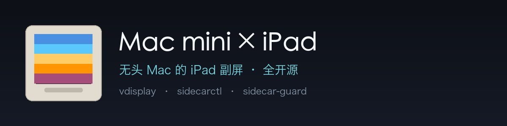
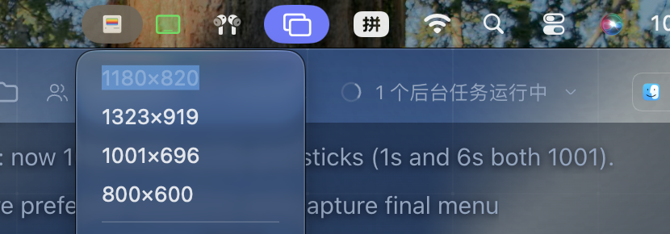
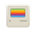

<p align="center">
  
</p>

<p align="center">
  <b>把一台没有显示器的 Mac mini，变成以 iPad 为唯一屏幕的工作站</b><br>
  自研虚拟屏 · 私有 API 直连 · 零第三方软件 · 开机自动连 · 断线自愈 · 系统级防篡改
</p>

<p align="center">
  
  
  
  
  
</p>

---

## 这是什么

**一台 Mac mini 放在客厅，没有显示器、没有键盘，只有一根电源线。**
你拿着 iPad 走到它旁边，iPad 自动亮起变成它的屏幕；你拿着 iPad 走开，它安静地等；你把 iPad 拿回来，它又自动连上。

这个项目做三件事：

| 能力 | 实现 |
|---|---|
| **制造一块"不存在的屏幕"** | `vdisplay`（自研，~120 行 ObjC，用 `CGVirtualDisplay` 私有接口） |
| **让 iPad 变成这块屏** | `sidecarctl`（自研，~110 行 ObjC，直接调 `SidecarCore` 私有 API） |
| **保证它一直可用** | `sidecar-guard`（守护）+ `protectd`（root 看护）+ 4 个 LaunchAgent |

**不装任何第三方 App。** 不是"免费替代品"，而是把苹果内置但没开放的通道直接用起来。

## 效果

<p align="center"></p>

| 指标 | 实测值 |
|---|---|
| 开机 → iPad 出现桌面 | **16～34 秒**（其中约 20 秒是系统蓝牙栈就绪） |
| 断线 → 自动恢复 | **2～10 秒** |
| 键盘（通用控制）建立链路 | **0 秒**（开机即用） |
| iPad 端点要求 | **无任何 App**，只要同一 Apple ID |
| 高位面板 | 2646×1838（HiDPI 2x，与 iPad 面板 1:1） |
| 第三方依赖 | **0** |

## 工作原理

```
┌──────────────────────────── Mac mini（无显示器）────────────────────────────┐
│                                                                              │
│  launchd                                                                     │
│    └─ com.dsh.vdisplay      → vdisplay      造一块虚拟屏 iPadLink-HD        │
│    └─ com.dsh.sidecar-guard → sidecar-guard 每 5 秒判断，需要就发起连接        │
│    └─ com.dsh.vmenu         → vmenu         菜单栏：切分辨率 / 暂停           │
│    └─ com.dsh.ucguard       → uc-guard      键盘链路看护（可选）              │
│                                                                              │
│  SidecarCore（苹果私有框架）                                                  │
│    SidecarDisplayManager.devices  → 同 iCloud 账号的 iPad 自动出现            │
│    connectToDevice:completion:    → 建立随航会话                              │
│                                                                              │
│  WindowServer → Sidecar Display → 镜像到 iPadLink-HD                        │
└──────────────────────────────────────────────────────────────────────────────┘
                                   ▲
                         同一 Apple ID + 蓝牙 + Wi-Fi（或 USB-C）
                                   ▼
                         ┌──────────────────┐
                         │  iPad（唯一屏幕） │  ← 不需要装任何 App
                         └──────────────────┘
```

**关键点**：iPad 只做"被投屏"的一方。连接由 Mac 主动发起，所以 iPad 关机、锁屏、不装 App 都不影响方案设计。

## 组件与代码量

| 组件 | 语言 | 行数 | 作用 |
|---|---|---|---|
| `src/vdisplay.m` | ObjC | ~120 | 创建 HiDPI 虚拟屏，多档模式（800/1001/1180/1323） |
| `src/sidecarctl.m` | ObjC | ~110 | 列出设备 / 连接 / 断开，支持按 UUID 绑定 |
| `src/vmenu.m` | ObjC | ~330 | 菜单栏图标：4 档分辨率、当前档玻璃高亮、暂停/恢复 |
| `scripts/sidecar-guard` | Bash | ~150 | 触发式重连：USB > 近场 > 定时兜底 |
| `protectd/protectd` | Bash | ~130 | root 看护：文件还原、补锁、agent 重载、进程/心跳救援 |
| `scripts/sidecar-*` | Bash | ~200 | 状态、自检、报告、暂停、恢复 |

全部源码都在这个仓库里，没有编译好的二进制、没有闭源依赖。

## 快速开始

### 前置条件

- Apple Silicon Mac（实测 macOS 26/27），**同一 Apple ID** 的 iPad
- iPad 打开蓝牙 + Wi-Fi（USB-C 直连最稳）
- Mac 已登录该 Apple ID（随航的设备发现走 iCloud/IDS）

### 一键安装

```bash
git clone https://github.com/Duandayi/macmini-headless-ipad.git
cd macmini-headless-ipad
./install.sh
```

安装脚本会：

1. 检查前置条件（Xcode CLT、macOS 版本）
2. 编译 `vdisplay` / `sidecarctl` / `vmenu` 到 `~/.local/bin`
3. 安装 4 个 LaunchAgent 到 `~/Library/LaunchAgents`
4. 跑 `sidecar-doctor` 自检

然后（只需一次）：

```bash
sidecarctl list          # 应该能看到你的 iPad
sidecarctl connect       # 手动连一次，系统会记住镜像配置
sidecar-status           # 确认 connected=yes
```

### 用 AI 直接部署

本项目**为 AI 部署准备过**：

```
把仓库地址丢给任意编码 Agent，说：
"按 AGENTS.md 部署这个项目到本机，装完跑 sidecar-doctor，把结果给我"
```

`AGENTS.md` 写清了每一步、每个坑、每个校验点，Agent 不需要猜。

## 菜单栏

<p align="center"></p>

| 操作 | 结果 |
|---|---|
| 悬停图标 | 显示当前分辨率 |
| 点一下 | 展开 4 档：`1180×820`（原生 1:1）/ `1323×919` / `1001×696` / `800×600` |
| 当前档 | 浅蓝玻璃高亮 |
| 暂停自动重连 ⌘P | 用 iPad 做别的事（开会/打游戏）时点它；**10 分钟后自动恢复** |

## 系统级保护（重点）

> 起因：曾经因为某个清理软件清空了登录项，导致整套连接失效，而且**没有任何提示**。

现在这些组件被三层锁住：

| 层 | 机制 | 能挡住谁 |
|---|---|---|
| 1 | 主副本 `/usr/local/libexec/dsh-sidecar/` 全部 `schg`（系统级不可变）+ `root:wheel` | 连 **root** 都要先 `chflags noschg` |
| 2 | 用户副本 `~/.local/bin/` 全部 `uchg` | 普通程序写入 → `Operation not permitted` |
| 3 | root 守护每 **20 秒**巡检 | 内容被改→还原；标记掉了→补；agent 被卸载→重载；进程被杀→kickstart；**守护卡死→2 分钟内 SIGKILL 重启** |

实测（详见 [docs/系统级保护.md](docs/系统级保护.md)）：

| 攻击 | 结果 |
|---|---|
| 用户权限改二进制 | `Operation not permitted` |
| **管理员权限**改主副本 | `Operation not permitted`（schg） |
| `launchctl bootout` 卸载服务 | 约 40 秒后自动重载 |
| 解锁并修改用户副本 | 15 秒后还原 + 重新上锁 |
| `kill -STOP` 冻住守护 | 2 分钟内检测心跳过期 → SIGKILL → 重启 |

可选安装（需要一次管理员密码）：

```bash
sudo ./protectd/install-protectd.sh
```

**边界**：拿到管理员密码的人仍然能改（先 `chflags noschg`）。这是操作系统权限模型的上限，任何软件都一样。

## 排障

| 现象 | 原因 | 处理 |
|---|---|---|
| iPad 黑屏 | 虚拟屏没建起来 / 没连上 | `sidecar-status`、`sidecar-doctor` |
| 点菜单没反应 | 处在「暂停」状态 | 点「恢复自动重连」或 `sidecar-resume` |
| 连不上，提示 Wi-Fi 不可用 | iPad 关了 Wi-Fi | 打开 Wi-Fi，10 秒内自动连 |
| 找不到设备 | iPad 关机 / 蓝牙没开 | 开机 + 开蓝牙，最多 2 分钟自动连 |
| 画面模糊 | 分辨率不是 1:1 | 菜单选 `1180×820`（原生） |
| 键盘掉线 | 有别的显示增强软件在改配置 | 关掉它（本项目不需要任何此类软件） |

完整踩坑记录（含系统日志原文）：[docs/踩坑记录.md](docs/踩坑记录.md)

## 不只 iPad：其他人怎么用

连接环节用的是**随航（Sidecar）**，它只支持 iPad。如果是安卓平板：

| 环节 | 本项目 | 通用性 |
|---|---|---|
| A. 虚拟屏（让 Mac 以为有块屏） | `vdisplay` | ✅ 任何方案都能用 |
| B. 把画面送到设备 | 随航 | ❌ 仅 iPad |

- **安卓平板**：保留 A，把 B 换成 [Sunshine](https://github.com/LizardByte/Sunshine) + Moonlight 或 Deskreen
- **只想远程用这台 Mac**：买个 **HDMI 诱骗器**（几十元）最简单
- **没有平板**：本项目不适用

**不要为了用本项目去买 iPad。**

## 兼容性与测试状态（诚实说明）

- 实测机型：**Mac18,5 / Apple M6 / 16GB / macOS 27.0**
- 冷启动验证：**多次通过**（开机到连上 16～34 秒，0 次人工干预）
- 长期稳定性：**观察期进行中**（`sidecar-report` 记录每次开机耗时与干预次数）
- 未验证：更早的 macOS、Intel 机型、多台 iPad 同时在线
- 私有 API（`CGVirtualDisplay` / `SidecarCore`）**没有官方文档**，系统大版本升级后可能失效——届时 `sidecar-doctor` 会先报出来

遇到问题请附 `sidecar-doctor` 的输出开 issue。

## 目录结构

```
.
├── install.sh / uninstall.sh      安装 / 卸载
├── config.example.sh              配置样例（设备绑定、分辨率）
├── src/
│   ├── vdisplay.m                 虚拟屏
│   ├── sidecarctl.m               随航连接器
│   └── vmenu.m                    菜单栏
├── scripts/
│   ├── sidecar-guard              连接守护
│   ├── sidecar-doctor             环境自检（装完先跑）
│   ├── sidecar-status             实时状态
│   ├── sidecar-report             测试期报告
│   └── sidecar-pause / -resume    暂停 / 恢复
├── launchd/*.plist.template       开机自启模板
├── protectd/                      系统级保护（可选）
├── docs/
│   ├── 系统级保护.md
│   └── 踩坑记录.md
├── assets/                        Logo / 横幅 / 截图
└── AGENTS.md                      给 AI Agent 的部署说明
```

## 卸载

```bash
./uninstall.sh
# 若装了系统级保护：
sudo chflags noschg /usr/local/libexec/dsh-sidecar/* /usr/local/libexec/dsh-sidecar
sudo launchctl bootout system/com.dsh.sidecar-protect
sudo rm -rf /usr/local/libexec/dsh-sidecar /Library/LaunchDaemons/com.dsh.sidecar-protect.plist
```

## 贡献

欢迎 issue / PR。请注意：

- 本项目依赖**苹果私有接口**，任何改动都要在真机验证
- 涉及 `protectd` 的改动请说明安全性影响
- 不接受引入第三方运行时依赖（Node/Python 等）的改动

## License

[MIT](LICENSE) © 2026 Duandayi

## 致谢

- 苹果 `CGVirtualDisplay` / `SidecarCore`：这套方案能成立的前提
- 所有在无头 Mac 上折腾过的人：踩坑记录里的每一条都是真机日志

---

<p align="center"><sub>如果这个项目让一台吃灰的 Mac mini 重新有了用处，点个 ⭐ 就够了。</sub></p>
